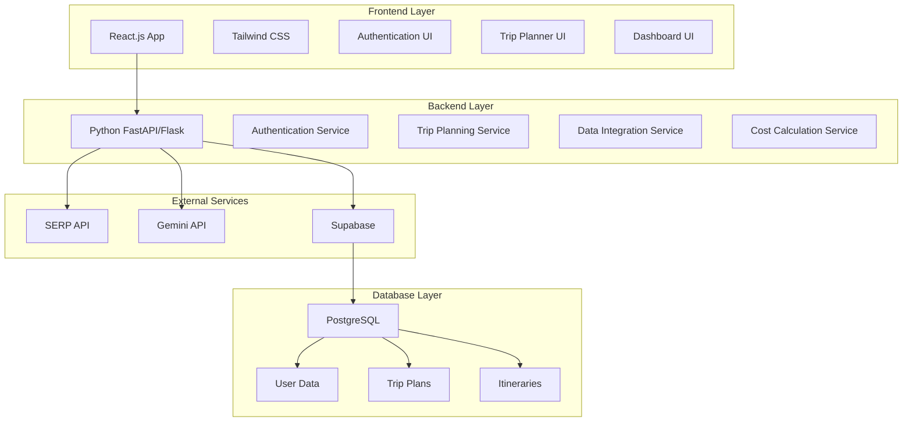
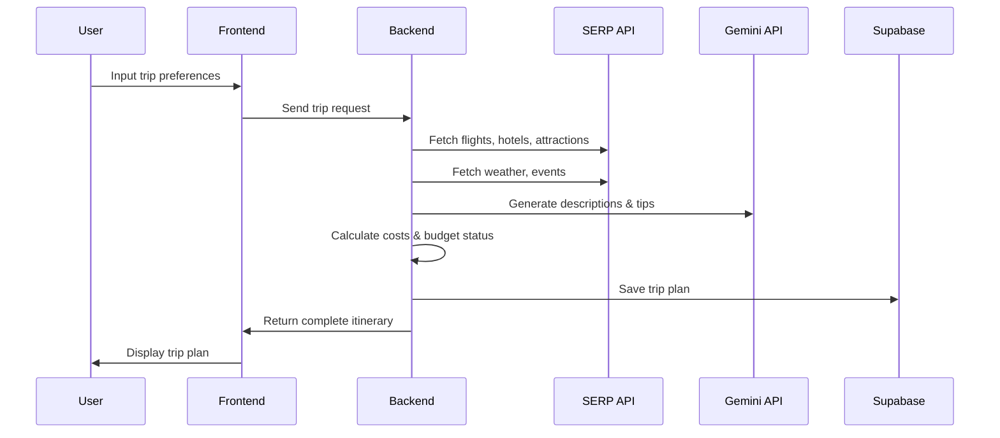

# Design Document

## Overview

The AI-powered Real-Time Trip Planner is a full-stack web application that combines real-time travel data, AI-generated content, and persistent storage to deliver comprehensive trip planning experiences. The system follows a three-tier architecture with a React frontend, Python backend, and Supabase database, integrating SERP API for travel data and Gemini API for content generation.

The application prioritizes user experience through responsive design, real-time data accuracy, and intelligent cost management, all while maintaining secure authentication and data persistence capabilities.

## Architecture

### System Architecture



### Data Flow Architecture



## Components and Interfaces

### Frontend Components

**Authentication Components**
- `LoginForm`: Handles user login with username/password validation
- `SignUpForm`: Manages user registration with email, username, password
- `AuthGuard`: Protects routes requiring authentication
- `AuthContext`: Manages authentication state across the application

**Trip Planning Components**
- `TripInputForm`: Collects user preferences (destination, dates, budget, interests)
- `ItineraryDisplay`: Shows day-by-day trip plans with activities and costs
- `CostBreakdown`: Displays section-wise and day-wise cost analysis
- `BudgetStatus`: Shows budget compliance and suggests alternatives
- `SavedTrips`: Lists and manages previously saved trip plans

**UI Enhancement Components**
- `ThemeToggle`: Switches between light and dark modes
- `SkeletonLoader`: Provides loading states during data fetching
- `ErrorBoundary`: Handles errors with friendly fallback UI
- `PDFExporter`: Generates downloadable trip itineraries
- `ShareableLink`: Creates and manages trip sharing functionality

### Backend Services

**Authentication Service**
```python
class AuthService:
    def authenticate_user(username: str, password: str) -> AuthResult
    def create_user(username: str, email: str, password: str) -> UserResult
    def hash_password(password: str) -> str
    def verify_password(password: str, hashed: str) -> bool
```

**Trip Planning Service**
```python
class TripPlanningService:
    def create_trip_plan(user_preferences: TripPreferences) -> TripPlan
    def generate_itinerary(trip_data: TripData, days: int) -> Itinerary
    def save_trip_plan(user_id: str, trip_plan: TripPlan) -> SaveResult
    def get_saved_trips(user_id: str) -> List[TripPlan]
```

**Data Integration Service**
```python
class DataIntegrationService:
    def fetch_flights(destination: str, dates: DateRange) -> FlightData
    def fetch_hotels(destination: str, budget: BudgetLevel) -> HotelData
    def fetch_attractions(destination: str, interests: List[str]) -> AttractionData
    def fetch_weather(destination: str, dates: DateRange) -> WeatherData
    def fetch_events(destination: str, dates: DateRange) -> EventData
```

**AI Content Service**
```python
class AIContentService:
    def generate_attraction_description(attraction: Attraction) -> str
    def generate_hotel_description(hotel: Hotel) -> str
    def generate_travel_tips(weather: Weather, destination: str) -> str
    def suggest_cost_savings(budget_status: BudgetStatus) -> str
```

### External API Interfaces

**SERP API Integration**
- Google Flights API: `/search?engine=google_flights`
- Google Hotels API: `/search?engine=google_hotels`
- Google Maps API: `/search?engine=google_maps`
- Google Local Places API: `/search?engine=google_local`

**Gemini API Integration**
- Text Generation: `models/gemini-1.5-flash:generateContent`
- Content parameters: temperature=0.7, max_tokens=150

## Data Models

### User Data Model
```python
@dataclass
class User:
    id: str
    username: str
    email: str
    password_hash: str
    created_at: datetime
    updated_at: datetime
```

### Trip Preferences Model
```python
@dataclass
class TripPreferences:
    destination: str
    start_date: date
    end_date: date
    travel_days: int
    travel_type: TravelType  # Solo, Friends, Family, Couple
    budget_preference: BudgetLevel  # low, medium, high
    max_budget_inr: float
    interests: List[Interest]  # nature, food, adventure, culture, shopping, nightlife
```

### Trip Plan Model
```python
@dataclass
class TripPlan:
    id: str
    user_id: str
    preferences: TripPreferences
    itinerary: Itinerary
    cost_breakdown: CostBreakdown
    budget_status: BudgetStatus
    created_at: datetime
    updated_at: datetime
```

### Itinerary Model
```python
@dataclass
class Itinerary:
    trip_id: str
    days: List[DayPlan]
    total_cost_inr: float
    
@dataclass
class DayPlan:
    day_number: int
    date: date
    activities: List[Activity]
    weather: WeatherInfo
    daily_cost_inr: float
```

### Cost Models
```python
@dataclass
class CostBreakdown:
    flight_cost_inr: float
    hotel_cost_inr: float
    attractions_cost_inr: float
    events_cost_inr: float
    local_expenses_inr: float
    total_cost_inr: float
    daily_breakdown: List[DailyCost]

@dataclass
class BudgetStatus:
    status: str  # "Within Budget", "Slightly Over Budget", "Over Budget"
    difference_inr: float
    suggestions: List[str]
```

### Database Schema

```sql
-- Users table
CREATE TABLE users (
    id UUID PRIMARY KEY DEFAULT gen_random_uuid(),
    username VARCHAR(50) UNIQUE NOT NULL,
    email VARCHAR(255) UNIQUE NOT NULL,
    password_hash VARCHAR(255) NOT NULL,
    created_at TIMESTAMP WITH TIME ZONE DEFAULT NOW(),
    updated_at TIMESTAMP WITH TIME ZONE DEFAULT NOW()
);

-- Trip plans table
CREATE TABLE trip_plans (
    id UUID PRIMARY KEY DEFAULT gen_random_uuid(),
    user_id UUID REFERENCES users(id) ON DELETE CASCADE,
    destination VARCHAR(255) NOT NULL,
    start_date DATE NOT NULL,
    end_date DATE NOT NULL,
    travel_days INTEGER NOT NULL,
    travel_type VARCHAR(20) NOT NULL,
    budget_preference VARCHAR(10) NOT NULL,
    max_budget_inr DECIMAL(10,2) NOT NULL,
    interests JSONB NOT NULL,
    total_cost_inr DECIMAL(10,2) NOT NULL,
    budget_status VARCHAR(50) NOT NULL,
    created_at TIMESTAMP WITH TIME ZONE DEFAULT NOW(),
    updated_at TIMESTAMP WITH TIME ZONE DEFAULT NOW()
);

-- Itineraries table
CREATE TABLE itineraries (
    id UUID PRIMARY KEY DEFAULT gen_random_uuid(),
    trip_plan_id UUID REFERENCES trip_plans(id) ON DELETE CASCADE,
    day_number INTEGER NOT NULL,
    date DATE NOT NULL,
    activities JSONB NOT NULL,
    weather_info JSONB NOT NULL,
    daily_cost_inr DECIMAL(10,2) NOT NULL,
    created_at TIMESTAMP WITH TIME ZONE DEFAULT NOW()
);

-- Cost breakdowns table
CREATE TABLE cost_breakdowns (
    id UUID PRIMARY KEY DEFAULT gen_random_uuid(),
    trip_plan_id UUID REFERENCES trip_plans(id) ON DELETE CASCADE,
    flight_cost_inr DECIMAL(10,2) NOT NULL,
    hotel_cost_inr DECIMAL(10,2) NOT NULL,
    attractions_cost_inr DECIMAL(10,2) NOT NULL,
    events_cost_inr DECIMAL(10,2) NOT NULL,
    local_expenses_inr DECIMAL(10,2) NOT NULL,
    created_at TIMESTAMP WITH TIME ZONE DEFAULT NOW()
);
```

## Correctness Properties

*A property is a characteristic or behavior that should hold true across all valid executions of a system—essentially, a formal statement about what the system should do. Properties serve as the bridge between human-readable specifications and machine-verifiable correctness guarantees.*

### Property 1: Authentication Validation
*For any* valid username and password combination, the authentication system should grant access to the application and maintain session state
**Validates: Requirements 1.2**

### Property 2: Invalid Credential Rejection
*For any* invalid username and password combination, the authentication system should reject access and display appropriate error messages
**Validates: Requirements 1.3**

### Property 3: User Registration with Password Security
*For any* valid registration data (username, email, password), the system should create a new user account with securely hashed password storage
**Validates: Requirements 1.5**

### Property 4: Authentication Guard Protection
*For any* unauthenticated user attempting to access protected routes, the system should redirect to the login page
**Validates: Requirements 1.6**

### Property 5: Input Validation Consistency
*For any* user input (dates, travel days, budget amounts), the system should validate according to business rules (future dates, positive integers, valid currency format)
**Validates: Requirements 2.2, 2.3, 2.6**

### Property 6: SERP API Data Structure Validation
*For any* SERP API response (flights, hotels, attractions, events, weather), the returned data should contain all required fields with proper data types
**Validates: Requirements 3.1, 3.2, 3.3, 3.4, 3.5**

### Property 7: Currency Conversion Consistency
*For any* cost data from external sources, all amounts should be converted and displayed consistently in ₹ INR format
**Validates: Requirements 3.6**

### Property 8: AI Content Generation Standards
*For any* travel item (attraction, hotel, event), the Gemini API should generate descriptions that are 2-3 lines in length and contextually relevant
**Validates: Requirements 4.1, 4.2, 4.3**

### Property 9: Conditional AI Content Generation
*For any* trip plan with weather data or budget constraints, the Gemini API should generate appropriate tips or cost-saving advice when conditions are met
**Validates: Requirements 4.4, 4.5**

### Property 10: API Responsibility Separation
*For any* Gemini API call, the request should only contain content generation parameters and never include data fetching operations
**Validates: Requirements 4.6**

### Property 11: Cost Calculation Completeness
*For any* trip plan, the cost calculation should include all required components (flights, hotels, attractions, events, local expenses) and produce accurate totals
**Validates: Requirements 5.1, 5.4**

### Property 12: Cost Breakdown Structure
*For any* trip cost calculation, the system should provide both section-wise and day-wise breakdowns with all required categories
**Validates: Requirements 5.2, 5.3**

### Property 13: Budget Status Classification
*For any* trip cost and maximum budget pair, the system should correctly classify the budget status as "Within Budget", "Slightly Over Budget", or "Over Budget"
**Validates: Requirements 5.5**

### Property 14: Budget Exceedance Response
*For any* trip plan where total cost exceeds the maximum budget, the system should provide specific cost-saving suggestions
**Validates: Requirements 5.6**

### Property 15: Itinerary Structure Generation
*For any* specified number of travel days, the itinerary should contain exactly that number of day plans with proper date sequencing
**Validates: Requirements 6.1**

### Property 16: Interest-Based Activity Selection
*For any* set of user interests, the selected activities should align with at least one of the specified interest categories
**Validates: Requirements 6.2**

### Property 17: Daily Information Completeness
*For any* day in the itinerary, the day plan should include weather information and calculated daily costs
**Validates: Requirements 6.3, 6.4**

### Property 18: Activity Selection Criteria
*For any* trip plan, the selected activities should be appropriate for the specified travel type and budget preference
**Validates: Requirements 6.5**

### Property 19: Trip Plan Persistence
*For any* generated trip plan, all components (preferences, itinerary, costs) should be stored and retrievable from the database
**Validates: Requirements 7.1**

### Property 20: User Data Isolation
*For any* user requesting saved plans, only that user's own trip plans should be returned
**Validates: Requirements 7.2**

### Property 21: Trip Comparison Display
*For any* set of saved trip plans, the comparison view should display all plans with consistent formatting and structure
**Validates: Requirements 7.3**

### Property 22: Offline Data Availability
*For any* offline scenario, the last generated itinerary should be accessible from local cache
**Validates: Requirements 7.4**

### Property 23: PDF Export Completeness
*For any* trip plan, the generated PDF should contain the complete itinerary and cost breakdown in a readable format
**Validates: Requirements 8.1**

### Property 24: Shareable Link Functionality
*For any* trip plan, the generated shareable link should display the complete trip information when accessed
**Validates: Requirements 8.2**

### Property 25: Theme Toggle Consistency
*For any* theme toggle action, all UI components should consistently switch between light and dark modes
**Validates: Requirements 8.3**

### Property 26: Loading State Display
*For any* data loading operation, skeleton loaders should be displayed until the operation completes
**Validates: Requirements 8.4**

### Property 27: Error Handling Gracefully
*For any* error condition, the system should display user-friendly error messages with appropriate fallback options
**Validates: Requirements 8.5**

### Property 28: Currency Toggle Functionality
*For any* currency toggle action, all displayed amounts should be converted and updated to the selected currency
**Validates: Requirements 8.6**

## Error Handling

### Authentication Errors
- Invalid credentials: Display clear error message without revealing whether username or password is incorrect
- Network failures: Provide retry mechanism with exponential backoff
- Session expiration: Automatically redirect to login with session timeout message

### API Integration Errors
- SERP API failures: Implement fallback data sources and graceful degradation
- Gemini API failures: Provide default descriptions and continue with core functionality
- Rate limiting: Implement request queuing and user feedback for delays
- Timeout handling: Set appropriate timeouts with user notification

### Data Validation Errors
- Input validation: Provide real-time feedback with specific error messages
- Date validation: Clear messaging for invalid date ranges or past dates
- Budget validation: Ensure positive values with currency format guidance

### Database Errors
- Connection failures: Implement retry logic with offline mode fallback
- Data corruption: Validate data integrity on read operations
- Storage limits: Provide user feedback when storage quotas are approached

### UI Error Boundaries
- Component failures: Isolate errors to prevent full application crashes
- Rendering errors: Provide fallback UI components for critical sections
- State management errors: Reset to safe state with user notification

## Testing Strategy

### Dual Testing Approach

The testing strategy employs both unit testing and property-based testing to ensure comprehensive coverage:

**Unit Tests**: Focus on specific examples, edge cases, and integration points between components. These tests validate concrete scenarios and catch specific bugs in implementation details.

**Property Tests**: Verify universal properties across all inputs through randomized testing. These tests ensure general correctness by validating that system behaviors hold true for any valid input combination.

Together, unit tests catch concrete implementation bugs while property tests verify that the system behaves correctly across the entire input space.

### Property-Based Testing Configuration

**Testing Library**: Use `hypothesis` for Python backend property tests and `fast-check` for JavaScript frontend property tests.

**Test Configuration**: Each property test must run a minimum of 100 iterations to ensure adequate coverage through randomization.

**Test Tagging**: Each property-based test must include a comment referencing its design document property:
- Format: `# Feature: ai-trip-planner, Property {number}: {property_text}`

**Property Implementation**: Each correctness property listed above must be implemented as a single property-based test that validates the specified behavior across generated inputs.

### Unit Testing Focus Areas

**Authentication Flow Testing**:
- Test specific login scenarios (admin/admin123 default credentials)
- Test registration form validation with specific invalid inputs
- Test session management and timeout scenarios

**API Integration Testing**:
- Mock SERP API responses with specific data structures
- Test Gemini API integration with sample prompts and responses
- Test error handling for specific API failure scenarios

**UI Component Testing**:
- Test specific form interactions and validation messages
- Test theme switching with specific UI state changes
- Test PDF generation with sample trip data

**Database Integration Testing**:
- Test specific CRUD operations with sample data
- Test data migration and schema validation
- Test concurrent access scenarios

### Test Data Management

**Generated Test Data**: Property tests will generate random but valid test data including:
- User credentials and registration information
- Trip preferences with various combinations of interests and budgets
- API response data matching expected schemas
- Cost calculations with different currency amounts

**Mock External Services**: All external API calls (SERP API, Gemini API) will be mocked in tests to ensure:
- Consistent test execution without external dependencies
- Controlled testing of error scenarios
- Fast test execution without network delays

**Database Testing**: Use test database instances with:
- Isolated test data that doesn't affect production
- Automated cleanup between test runs
- Schema validation for all data operations